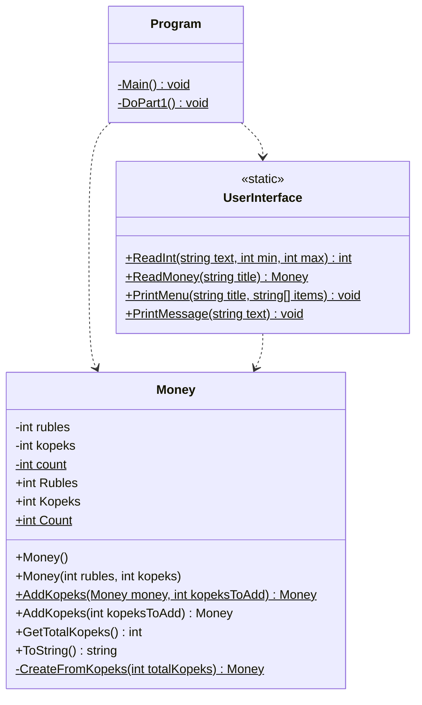
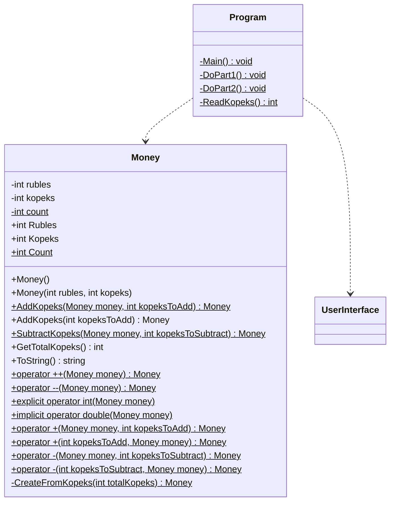
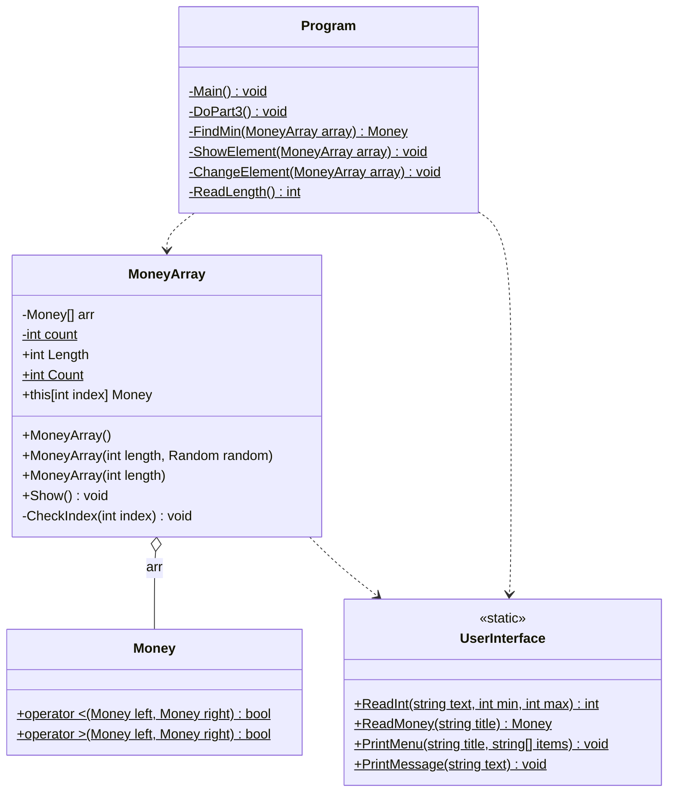

# Лабораторная работа № 9

**Классы и объекты**

**Выполнил:** Роговик Никита  
**Группа:** ИВТ-25-2б  
**Вариант:** 17(2)

## 1. Постановка задачи

### 1.1. Общая постановка

**Часть 1.** Реализовать в отдельном файле новый класс: закрытые поля, свойства,
конструкторы, инициализация и вывод полей. В главной функции создать объекты и
вывести их поля. Написать функцию из варианта в двух видах: статической функцией
и методом класса. Статическим полем подсчитать количество созданных объектов.

**Часть 2.** Добавить в класс перегруженные операции из варианта и показать их
работу в демонстрационной программе.

**Часть 3.** Реализовать в отдельном файле класс-коллекцию, полем которого является
одномерный массив элементов класса из части 1 (стандартные коллекции C# не
используются). В классе сделать:

- конструктор без параметров;
- конструктор с параметрами, заполняющий массив случайными значениями;
- конструктор с параметрами, заполняющий массив значениями с клавиатуры;
- метод для просмотра элементов;
- индексатор с проверкой выхода индекса за пределы массива (`throw new ArgumentException()`).

Подсчитать количество созданных объектов. Написать функцию в классе `Program`
для задания варианта, используя индексатор.

**Методические указания:** ввод и вывод выполняются в отдельном классе,
конструкторы заполняют поля через свойства, количество объектов хранится
в статической переменной.

### 1.2. Задание варианта

В задании 15 вариантов, поэтому для номера 17 взят вариант 17 − 15 = **2**,
класс **`Money`** с полями `int rubles`, `int kopeks`.

1. Добавление копеек (`int`) к объекту типа `Money`, копеек не может быть больше 99.
   Результат типа `Money`.
2. Операции:
   - `++` — добавление копейки (копеек не больше 99);
   - `--` — вычитание копейки (рублей и копеек не меньше 0);
   - `int` (явное приведение) — количество рублей, копейки отбрасываются;
   - `double` (неявное приведение) — копейки, рубли отбрасываются, результат меньше 1;
   - `+` `Money`, целое число (лево- и правосторонняя), копеек не больше 99;
   - `−` `Money`, целое число (лево- и правосторонняя), рублей и копеек не меньше 0.
3. Коллекция `MoneyArray`, задание — **минимальное значение**.

## 2. Анализ

### 2.1. Входные и выходные данные

**Входные данные:** пункты меню; сумма — рубли (целое от 0 до 1 000 000) и
копейки (целое от 0 до 99); число копеек для операций (целое от 0 до 1 000 000);
количество элементов массива (от 1 до 100); индекс элемента (любое целое).

**Выходные данные:** суммы в виде «X руб. Y коп.», результат приведения к `int`
и `double`, количество созданных объектов `Money` и `MoneyArray`, элементы массива,
минимальное значение, сообщения об ошибках.

### 2.2. Словесный алгоритм

Все операции с деньгами сделаны одинаково: сумма переводится в копейки
(`рубли * 100 + копейки`), к ней прибавляется или из неё вычитается число копеек,
потом результат снова раскладывается на рубли (`/ 100`) и копейки (`% 100`).
Так копеек всегда получается от 0 до 99. Если после вычитания получилось меньше
нуля, результатом считается 0 руб. 0 коп.

Например, 10 руб. 50 коп. + 75 коп.: 1050 + 75 = 1125 коп. = 11 руб. 25 коп.

Каждая операция возвращает **новый** объект, исходный не меняется. Поэтому
результаты операций тоже увеличивают счётчик объектов.

**Поиск минимума:** первый элемент запоминается как минимальный, затем через
индексатор просматриваются остальные. Если элемент меньше запомненного
(перегруженная операция `<` сравнивает суммы в копейках), он становится минимальным.

### 2.3. Принятые решения по неясным местам задания

- **Правосторонняя операция `число − Money`.** Вычитать деньги из числа копеек
  не имеет смысла, поэтому `число − Money` работает так же, как `Money − число`:
  из суммы вычитается число копеек.
- **Результат меньше нуля.** Задание говорит, что рублей и копеек не может быть
  меньше 0, поэтому такой результат заменяется на 0 руб. 0 коп.
- **Конструктор «с клавиатуры».** Сам конструктор не работает с консолью: он вызывает
  `UserInterface.ReadMoney`. Метод `Show` тоже выводит элементы через `UserInterface`.
  Так весь ввод и вывод остаётся в классе `UserInterface`.
- **Операция `>`.** В C# операции `<` и `>` объявляются только парой, поэтому
  для поиска минимума добавлены обе.

### 2.4. Классы входных и выходных данных

Классы перечислены в разделе 6 (таблицы чёрного ящика).

### 2.5. Исключительные ситуации

| Ситуация | Результат |
| --- | --- |
| Введены буквы или пустая строка вместо числа | «Ошибка: нужно ввести целое число.», ввод повторяется |
| Число не помещается в `int` | «Ошибка: слишком большое число.», ввод повторяется |
| Число вне диапазона (пункт меню, рубли, копейки, количество элементов) | «Ошибка: нужно число от … до ….», ввод повторяется |
| Вычитание больше, чем есть, или `--` у 0 руб. 0 коп. | Результат 0 руб. 0 коп. |
| Индекс за пределами массива | Индексатор бросает `ArgumentException`, программа выводит «Ошибка: Индекс за пределами массива.» |
| Поиск минимума в пустом массиве | «Ошибка: массив пустой, искать нечего.» |
| Вывод пустого массива | «Массив пустой.» |
| Неверное значение в свойстве `Rubles` или `Kopeks` | `ArgumentException`; через меню такое значение ввести нельзя |

## 3. Проектирование

Программа состоит из четырёх файлов:

| Файл | Класс | Назначение |
| --- | --- | --- |
| `Money.cs` | `Money` | Денежная сумма (части 1 и 2, операции `<`, `>` для части 3) |
| `MoneyArray.cs` | `MoneyArray` | Коллекция сумм (часть 3) |
| `UserInterface.cs` | `UserInterface` | Ввод и вывод |
| `Program.cs` | `Program` | Меню и демонстрация трёх частей, поиск минимума |

Меню:

```text
Главное меню
├── 1. Часть 1. Класс Money
├── 2. Часть 2. Перегруженные операции
│   ├── 1. Ввести сумму
│   ├── 2. ++ (добавить копейку)
│   ├── 3. -- (вычесть копейку)
│   ├── 4. Явное приведение к int (рубли)
│   ├── 5. Неявное приведение к double (копейки)
│   ├── 6. Сумма + число
│   ├── 7. Число + сумма
│   ├── 8. Сумма - число
│   ├── 9. Число - сумма
│   └── 0. Назад
├── 3. Часть 3. Коллекция MoneyArray
│   ├── 1. Создать пустой массив
│   ├── 2. Создать массив со случайными значениями
│   ├── 3. Создать массив с клавиатуры
│   ├── 4. Вывести массив
│   ├── 5. Получить элемент по индексу
│   ├── 6. Изменить элемент по индексу
│   ├── 7. Найти минимальное значение
│   └── 0. Назад
└── 0. Выход
```

Часть 1 выполняется без подменю: создаются объекты конструкторами без параметров
и с параметрами, вводится сумма, к ней добавляются копейки двумя способами,
выводится количество объектов.

### 3.1. Диаграмма классов. Часть 1



### 3.2. Диаграмма классов. Часть 2

К классу `Money` добавлены операции. Статические члены на диаграмме подчёркнуты.



### 3.3. Диаграмма классов. Часть 3

У класса `Money` показаны только члены, добавленные в этой части.



### 3.4. Функции и методы

| Класс | Член | Назначение |
| --- | --- | --- |
| `Money` | `Rubles`, `Kopeks` | Свойства с проверкой значения (рубли ≥ 0, копейки 0–99) |
| `Money` | `Count` | Количество созданных объектов `Money` |
| `Money` | `Money()`, `Money(int rubles, int kopeks)` | Конструкторы, заполняют поля через свойства и увеличивают счётчик |
| `Money` | `static AddKopeks(Money money, int kopeksToAdd)` | Часть 1, статическая функция добавления копеек |
| `Money` | `AddKopeks(int kopeksToAdd)` | Часть 1, метод класса добавления копеек |
| `Money` | `static SubtractKopeks(Money money, int kopeksToSubtract)` | Вычитание копеек, нужно для `--` и `−` |
| `Money` | `GetTotalKopeks()` | Сумма в копейках |
| `Money` | `ToString()` | Строка «X руб. Y коп.» для вывода |
| `Money` | `++`, `--`, `(int)`, `(double)`, `+`, `−` | Часть 2, перегруженные операции |
| `Money` | `<`, `>` | Часть 3, сравнение сумм |
| `Money` | `CreateFromKopeks(int totalKopeks)` | Раскладывает копейки на рубли и копейки, отрицательное значение заменяет нулём |
| `MoneyArray` | три конструктора | Пустой массив, случайные значения, ввод с клавиатуры |
| `MoneyArray` | `this[int index]` | Индексатор с проверкой индекса |
| `MoneyArray` | `Show()` | Просмотр элементов |
| `MoneyArray` | `Length`, `Count` | Длина массива и количество созданных коллекций |
| `MoneyArray` | `CheckIndex(int index)` | Бросает `ArgumentException`, если индекс за пределами массива |
| `UserInterface` | `ReadInt`, `ReadMoney` | Ввод числа с проверкой и ввод суммы |
| `UserInterface` | `PrintMenu`, `PrintMessage` | Вывод меню и сообщений |
| `Program` | `Main`, `DoPart1`, `DoPart2`, `DoPart3` | Главное меню и демонстрация частей |
| `Program` | `FindMin(MoneyArray array)` | Задание варианта: минимальное значение |
| `Program` | `ShowElement`, `ChangeElement` | Чтение и изменение элемента через индексатор, обработка исключения |
| `Program` | `ReadKopeks`, `ReadLength` | Ввод числа копеек и количества элементов |

## 4. Код программы

### Money.cs

```csharp
using System;

public class Money
{
    private int rubles;
    private int kopeks;
    private static int count = 0;

    public int Rubles
    {
        get => rubles;
        set
        {
            if (value < 0)
                throw new ArgumentException("Рублей не может быть меньше 0.");
            rubles = value;
        }
    }

    public int Kopeks
    {
        get => kopeks;
        set
        {
            if (value < 0 || value > 99)
                throw new ArgumentException("Копеек должно быть от 0 до 99.");
            kopeks = value;
        }
    }

    public static int Count => count;

    public Money()
    {
        Rubles = 0;
        Kopeks = 0;
        count++;
    }

    public Money(int rubles, int kopeks)
    {
        Rubles = rubles;
        Kopeks = kopeks;
        count++;
    }

    // Часть 1. Статическая функция: добавление копеек
    public static Money AddKopeks(Money money, int kopeksToAdd)
    {
        return CreateFromKopeks(money.GetTotalKopeks() + kopeksToAdd);
    }

    // Часть 1. Метод класса: добавление копеек
    public Money AddKopeks(int kopeksToAdd)
    {
        return AddKopeks(this, kopeksToAdd);
    }

    public static Money SubtractKopeks(Money money, int kopeksToSubtract)
    {
        return CreateFromKopeks(money.GetTotalKopeks() - kopeksToSubtract);
    }

    public int GetTotalKopeks()
    {
        return rubles * 100 + kopeks;
    }

    public override string ToString()
    {
        return $"{rubles} руб. {kopeks} коп.";
    }

    // Часть 2. Унарные операции
    public static Money operator ++(Money money)
    {
        return AddKopeks(money, 1);
    }

    public static Money operator --(Money money)
    {
        return SubtractKopeks(money, 1);
    }

    // Часть 2. Операции приведения типа
    public static explicit operator int(Money money)
    {
        return money.rubles;
    }

    public static implicit operator double(Money money)
    {
        return money.kopeks / 100.0;
    }

    // Часть 2. Бинарные операции с целым числом (копейки)
    public static Money operator +(Money money, int kopeksToAdd)
    {
        return AddKopeks(money, kopeksToAdd);
    }

    public static Money operator +(int kopeksToAdd, Money money)
    {
        return AddKopeks(money, kopeksToAdd);
    }

    public static Money operator -(Money money, int kopeksToSubtract)
    {
        return SubtractKopeks(money, kopeksToSubtract);
    }

    public static Money operator -(int kopeksToSubtract, Money money)
    {
        return SubtractKopeks(money, kopeksToSubtract);
    }

    // Часть 3. Сравнение сумм нужно для поиска минимального значения
    public static bool operator <(Money left, Money right)
    {
        return left.GetTotalKopeks() < right.GetTotalKopeks();
    }

    public static bool operator >(Money left, Money right)
    {
        return left.GetTotalKopeks() > right.GetTotalKopeks();
    }

    // Сумма в копейках раскладывается на рубли и копейки.
    // Отрицательной суммы быть не может, поэтому она заменяется нулём.
    private static Money CreateFromKopeks(int totalKopeks)
    {
        if (totalKopeks < 0)
            totalKopeks = 0;
        return new Money(totalKopeks / 100, totalKopeks % 100);
    }
}
```

### MoneyArray.cs

```csharp
using System;

public class MoneyArray
{
    private Money[] arr;
    private static int count = 0;

    public int Length => arr.Length;

    public static int Count => count;

    public MoneyArray()
    {
        arr = new Money[0];
        count++;
    }

    // Заполнение случайными суммами: от 0 до 100 рублей и от 0 до 99 копеек
    public MoneyArray(int length, Random random)
    {
        arr = new Money[length];
        for (int i = 0; i < length; i++)
            arr[i] = new Money(random.Next(0, 101), random.Next(0, 100));
        count++;
    }

    // Заполнение суммами, которые пользователь вводит с клавиатуры
    public MoneyArray(int length)
    {
        arr = new Money[length];
        for (int i = 0; i < length; i++)
            arr[i] = UserInterface.ReadMoney($"Элемент [{i}]");
        count++;
    }

    public Money this[int index]
    {
        get
        {
            CheckIndex(index);
            return arr[index];
        }
        set
        {
            CheckIndex(index);
            arr[index] = value;
        }
    }

    public void Show()
    {
        if (arr.Length == 0)
        {
            UserInterface.PrintMessage("Массив пустой.");
            return;
        }

        for (int i = 0; i < arr.Length; i++)
            UserInterface.PrintMessage($"[{i}] {arr[i]}");
    }

    private void CheckIndex(int index)
    {
        if (index < 0 || index >= arr.Length)
            throw new ArgumentException("Индекс за пределами массива.");
    }
}
```

### UserInterface.cs

```csharp
using System;

public static class UserInterface
{
    public static int ReadInt(string text, int min, int max)
    {
        int number = 0;
        bool isCorrect = false;

        do
        {
            Console.Write(text);
            try
            {
                number = Convert.ToInt32(Console.ReadLine());
                if (number < min || number > max)
                    Console.WriteLine($"Ошибка: нужно число от {min} до {max}.");
                else
                    isCorrect = true;
            }
            catch (FormatException)
            {
                Console.WriteLine("Ошибка: нужно ввести целое число.");
            }
            catch (OverflowException)
            {
                Console.WriteLine("Ошибка: слишком большое число.");
            }
        }
        while (!isCorrect);

        return number;
    }

    public static Money ReadMoney(string title)
    {
        Console.WriteLine(title);
        int rubles = ReadInt("Рубли: ", 0, 1000000);
        int kopeks = ReadInt("Копейки: ", 0, 99);
        return new Money(rubles, kopeks);
    }

    public static void PrintMenu(string title, params string[] items)
    {
        Console.WriteLine();
        Console.WriteLine(title);
        foreach (string item in items)
            Console.WriteLine(item);
    }

    public static void PrintMessage(string text)
    {
        Console.WriteLine(text);
    }
}
```

### Program.cs

```csharp
using System;

internal class Program
{
    private static void Main()
    {
        int choice;

        UserInterface.PrintMessage("Лаба 9. Вариант 17 (в задании вариант 2, класс Money)");

        do
        {
            UserInterface.PrintMenu("Главное меню",
                "1. Часть 1. Класс Money",
                "2. Часть 2. Перегруженные операции",
                "3. Часть 3. Коллекция MoneyArray",
                "0. Выход");
            choice = UserInterface.ReadInt("Выберите пункт: ", 0, 3);

            switch (choice)
            {
                case 1:
                    DoPart1();
                    break;
                case 2:
                    DoPart2();
                    break;
                case 3:
                    DoPart3();
                    break;
            }
        }
        while (choice != 0);
    }

    private static void DoPart1()
    {
        UserInterface.PrintMessage("\nЧасть 1");

        Money emptyMoney = new Money();
        UserInterface.PrintMessage("Конструктор без параметров: " + emptyMoney);

        Money fixedMoney = new Money(5, 50);
        UserInterface.PrintMessage("Конструктор с параметрами (5, 50): " + fixedMoney);

        Money money = UserInterface.ReadMoney("Введите сумму:");
        UserInterface.PrintMessage($"Рубли: {money.Rubles}, копейки: {money.Kopeks}");

        int kopeksToAdd = UserInterface.ReadInt("Сколько копеек добавить: ", 0, 1000000);
        Money staticResult = Money.AddKopeks(money, kopeksToAdd);
        Money methodResult = money.AddKopeks(kopeksToAdd);
        UserInterface.PrintMessage("Статическая функция: " + staticResult);
        UserInterface.PrintMessage("Метод класса: " + methodResult);

        UserInterface.PrintMessage("Создано объектов Money: " + Money.Count);
    }

    private static void DoPart2()
    {
        Money money = new Money();
        int choice;

        do
        {
            UserInterface.PrintMenu($"Часть 2. Текущая сумма: {money} Создано объектов Money: {Money.Count}",
                "1. Ввести сумму",
                "2. ++ (добавить копейку)",
                "3. -- (вычесть копейку)",
                "4. Явное приведение к int (рубли)",
                "5. Неявное приведение к double (копейки)",
                "6. Сумма + число",
                "7. Число + сумма",
                "8. Сумма - число",
                "9. Число - сумма",
                "0. Назад");
            choice = UserInterface.ReadInt("Выберите пункт: ", 0, 9);

            switch (choice)
            {
                case 1:
                    money = UserInterface.ReadMoney("Введите сумму:");
                    break;
                case 2:
                    money++;
                    UserInterface.PrintMessage("Результат: " + money);
                    break;
                case 3:
                    money--;
                    UserInterface.PrintMessage("Результат: " + money);
                    break;
                case 4:
                    int rubles = (int)money;
                    UserInterface.PrintMessage("(int) = " + rubles);
                    break;
                case 5:
                    double kopeksPart = money;
                    UserInterface.PrintMessage("double = " + kopeksPart);
                    break;
                case 6:
                    int addRight = ReadKopeks();
                    UserInterface.PrintMessage($"{money} + {addRight} = {money + addRight}");
                    break;
                case 7:
                    int addLeft = ReadKopeks();
                    UserInterface.PrintMessage($"{addLeft} + {money} = {addLeft + money}");
                    break;
                case 8:
                    int subtractRight = ReadKopeks();
                    UserInterface.PrintMessage($"{money} - {subtractRight} = {money - subtractRight}");
                    break;
                case 9:
                    int subtractLeft = ReadKopeks();
                    UserInterface.PrintMessage($"{subtractLeft} - {money} = {subtractLeft - money}");
                    break;
            }
        }
        while (choice != 0);
    }

    private static void DoPart3()
    {
        MoneyArray array = new MoneyArray();
        Random random = new Random();
        int choice;

        do
        {
            UserInterface.PrintMenu($"Часть 3. Создано объектов MoneyArray: {MoneyArray.Count}, Money: {Money.Count}",
                "1. Создать пустой массив",
                "2. Создать массив со случайными значениями",
                "3. Создать массив с клавиатуры",
                "4. Вывести массив",
                "5. Получить элемент по индексу",
                "6. Изменить элемент по индексу",
                "7. Найти минимальное значение",
                "0. Назад");
            choice = UserInterface.ReadInt("Выберите пункт: ", 0, 7);

            switch (choice)
            {
                case 1:
                    array = new MoneyArray();
                    array.Show();
                    break;
                case 2:
                    array = new MoneyArray(ReadLength(), random);
                    array.Show();
                    break;
                case 3:
                    array = new MoneyArray(ReadLength());
                    array.Show();
                    break;
                case 4:
                    array.Show();
                    break;
                case 5:
                    ShowElement(array);
                    break;
                case 6:
                    ChangeElement(array);
                    break;
                case 7:
                    if (array.Length == 0)
                    {
                        UserInterface.PrintMessage("Ошибка: массив пустой, искать нечего.");
                        break;
                    }
                    UserInterface.PrintMessage("Минимальное значение: " + FindMin(array));
                    break;
            }
        }
        while (choice != 0);
    }

    // Часть 3. Задание варианта: минимальное значение в массиве
    private static Money FindMin(MoneyArray array)
    {
        Money min = array[0];
        for (int i = 1; i < array.Length; i++)
        {
            if (array[i] < min)
                min = array[i];
        }
        return min;
    }

    private static void ShowElement(MoneyArray array)
    {
        int index = UserInterface.ReadInt("Индекс: ", int.MinValue, int.MaxValue);
        try
        {
            UserInterface.PrintMessage($"[{index}] {array[index]}");
        }
        catch (ArgumentException exception)
        {
            UserInterface.PrintMessage("Ошибка: " + exception.Message);
        }
    }

    private static void ChangeElement(MoneyArray array)
    {
        int index = UserInterface.ReadInt("Индекс: ", int.MinValue, int.MaxValue);
        try
        {
            Money oldValue = array[index];
            array[index] = UserInterface.ReadMoney("Новое значение:");
            UserInterface.PrintMessage($"[{index}] {oldValue} -> {array[index]}");
        }
        catch (ArgumentException exception)
        {
            UserInterface.PrintMessage("Ошибка: " + exception.Message);
        }
    }

    private static int ReadKopeks()
    {
        return UserInterface.ReadInt("Число (копейки): ", 0, 1000000);
    }

    private static int ReadLength()
    {
        return UserInterface.ReadInt("Количество элементов: ", 1, 100);
    }
}
```

## 5. Тесты

Тесты выполнены запуском программы. Каждый тест — отдельный запуск, поэтому
счётчики объектов начинаются с нуля. Те же таблицы есть в файле
`Тесты — Лабораторная работа 9.xlsx`.

| № | Исходные данные | Ожидаемый результат | Получено |
| --- | --- | --- | --- |
| Т1 | Часть 1: сумма 10 руб. 50 коп., добавить 75 коп. | Конструкторы: 0 руб. 0 коп. и 5 руб. 50 коп.; Рубли: 10, копейки: 50; статическая функция и метод: 11 руб. 25 коп.; создано объектов Money: 5 | + |
| Т2 | Часть 1: рубли «abc», −1, 0; копейки 100, 99; добавить 0 коп. | «нужно ввести целое число», «нужно число от 0 до 1000000», «нужно число от 0 до 99»; результат 0 руб. 99 коп. (оба способа) | + |
| Т3 | Часть 1: сумма 3 руб. 0 коп., добавить 250 коп. | Статическая функция и метод: 5 руб. 50 коп. | + |
| Т4 | Часть 2: сумма 1 руб. 99 коп.; ++; --; (int); (double) | ++ → 2 руб. 0 коп.; -- → 1 руб. 99 коп.; (int) = 1; double = 0,99 | + |
| Т5 | Часть 2: сумма 0 руб. 0 коп.: --; сумма 0 руб. 5 коп.: сумма − 10; 10 − сумма | -- → 0 руб. 0 коп.; 0 руб. 0 коп.; 0 руб. 0 коп. | + |
| Т6 | Часть 2: сумма 2 руб. 50 коп.: сумма + 75; 75 + сумма; сумма − 60; 60 − сумма | 3 руб. 25 коп.; 3 руб. 25 коп.; 1 руб. 90 коп.; 1 руб. 90 коп. | + |
| Т7 | Часть 3: пустой массив: вывести; минимум; получить [0]; изменить [0] | «Массив пустой.»; «Ошибка: массив пустой, искать нечего.»; «Ошибка: Индекс за пределами массива.» (2 раза) | + |
| Т8 | Часть 3: с клавиатуры 3 элемента: 5 руб. 50 коп., 2 руб. 10 коп., 7 руб. 0 коп.; вывести; минимум; получить [1], [3], [−1]; изменить [0] на 1 руб. 5 коп.; минимум; изменить [9] | Вывод [0]…[2]; минимум 2 руб. 10 коп.; [1] 2 руб. 10 коп.; ошибка индекса (2 раза); [0] 5 руб. 50 коп. -> 1 руб. 5 коп.; минимум 1 руб. 5 коп.; ошибка индекса; объектов MoneyArray: 2, Money: 3, затем 4 | + |
| Т9 | Часть 3: случайный массив из 5 элементов; минимум; создать пустой массив | 5 сумм от 0 до 100 руб.; минимум — наименьшая из выведенных; «Массив пустой.»; объектов MoneyArray: 3 | + |
| Т10 | Главное меню: 4, x, пустая строка, 99999999999, 3; часть 3, случайный массив: количество 0, 101, 3 | «нужно число от 0 до 3», «нужно ввести целое число» (2 раза), «слишком большое число»; «нужно число от 1 до 100» (2 раза); массив из 3 элементов | + |

В Т1 создано 5 объектов `Money`: два конструктором для демонстрации, один при вводе
суммы, по одному — результаты статической функции и метода.

Результат Т8 (ввод с клавиатуры):

```text
[0] 5 руб. 50 коп.
[1] 2 руб. 10 коп.
[2] 7 руб. 0 коп.
Минимальное значение: 2 руб. 10 коп.
Индекс: [1] 2 руб. 10 коп.
Индекс: Ошибка: Индекс за пределами массива.
Индекс: Ошибка: Индекс за пределами массива.
[0] 5 руб. 50 коп. -> 1 руб. 5 коп.
Минимальное значение: 1 руб. 5 коп.
```

Результат Т9 (случайный массив):

```text
[0] 60 руб. 26 коп.
[1] 82 руб. 21 коп.
[2] 72 руб. 21 коп.
[3] 4 руб. 11 коп.
[4] 7 руб. 21 коп.
Минимальное значение: 4 руб. 11 коп.
```

## 6. Анализ покрытия кода тестами

### Чёрный ящик

| Класс входных данных | Т1 | Т2 | Т3 | Т4 | Т5 | Т6 | Т7 | Т8 | Т9 | Т10 |
| --- | --- | --- | --- | --- | --- | --- | --- | --- | --- | --- |
| Корректный ввод числа | + | + | + | + | + | + | + | + | + | + |
| Не число (в том числе пустой ввод) |  | + |  |  |  |  |  |  |  | + |
| Слишком большое число |  |  |  |  |  |  |  |  |  | + |
| Число вне диапазона |  | + |  |  |  |  |  |  |  | + |
| Добавление без перехода через рубль |  | + |  |  |  |  |  |  |  |  |
| Добавление с переходом через рубль | + |  |  | + |  | + |  |  |  |  |
| Добавление с переходом через несколько рублей |  |  | + |  |  |  |  |  |  |  |
| Вычитание с займом рубля |  |  |  | + |  | + |  |  |  |  |
| Вычитание больше, чем есть (результат меньше 0) |  |  |  |  | + |  |  |  |  |  |
| Правосторонняя операция (число слева) |  |  |  |  | + | + |  |  |  |  |
| Приведение к int и double |  |  |  | + |  |  |  |  |  |  |
| Массив: конструктор без параметров |  |  |  |  |  |  | + |  | + |  |
| Массив: случайное заполнение |  |  |  |  |  |  |  |  | + | + |
| Массив: заполнение с клавиатуры |  |  |  |  |  |  |  | + |  |  |
| Индекс в пределах массива |  |  |  |  |  |  |  | + |  |  |
| Индекс больше или равен длине |  |  |  |  |  |  | + | + |  |  |
| Отрицательный индекс |  |  |  |  |  |  |  | + |  |  |
| Минимум не на первом месте |  |  |  |  |  |  |  | + | + |  |
| Минимум на первом месте |  |  |  |  |  |  |  | + |  |  |

| Класс выходных данных | Т1 | Т2 | Т3 | Т4 | Т5 | Т6 | Т7 | Т8 | Т9 | Т10 |
| --- | --- | --- | --- | --- | --- | --- | --- | --- | --- | --- |
| Сумма Money | + | + | + | + | + | + |  | + | + |  |
| Целое число (рубли) |  |  |  | + |  |  |  |  |  |  |
| Вещественное число (копейки) |  |  |  | + |  |  |  |  |  |  |
| Количество созданных объектов | + | + |  |  |  |  |  | + | + |  |
| Сообщение об ошибке ввода |  | + |  |  |  |  |  |  |  | + |
| «Индекс за пределами массива.» |  |  |  |  |  |  | + | + |  |  |
| «Массив пустой.» |  |  |  |  |  |  | + |  | + |  |
| «массив пустой, искать нечего» |  |  |  |  |  |  | + |  |  |  |

Покрыто 27 из 27 классов, то есть **100%**.

### Покрытие методов и ветвей (белый ящик)

| Метод / ветвь | Т1 | Т2 | Т3 | Т4 | Т5 | Т6 | Т7 | Т8 | Т9 | Т10 |
| --- | --- | --- | --- | --- | --- | --- | --- | --- | --- | --- |
| Money: Rubles: value < 0 → исключение |  |  |  |  |  |  |  |  |  |  |
| Money: Rubles: допустимое значение | + | + | + | + | + | + |  | + | + |  |
| Money: Kopeks: value < 0 или > 99 → исключение |  |  |  |  |  |  |  |  |  |  |
| Money: Kopeks: допустимое значение | + | + | + | + | + | + |  | + | + |  |
| Money: Money() | + | + | + | + | + | + |  |  |  |  |
| Money: Money(rubles, kopeks) | + | + | + | + | + | + |  | + | + |  |
| Money: AddKopeks (статическая) | + | + | + |  |  |  |  |  |  |  |
| Money: AddKopeks (метод класса) | + | + | + |  |  |  |  |  |  |  |
| Money: SubtractKopeks |  |  |  | + | + | + |  |  |  |  |
| Money: CreateFromKopeks: totalKopeks < 0 → 0 |  |  |  |  | + |  |  |  |  |  |
| Money: CreateFromKopeks: totalKopeks ≥ 0 | + | + | + | + |  | + |  |  |  |  |
| Money: operator ++ |  |  |  | + |  |  |  |  |  |  |
| Money: operator -- |  |  |  | + | + |  |  |  |  |  |
| Money: explicit operator int |  |  |  | + |  |  |  |  |  |  |
| Money: implicit operator double |  |  |  | + |  |  |  |  |  |  |
| Money: operator + (Money, int) |  |  |  |  |  | + |  |  |  |  |
| Money: operator + (int, Money) |  |  |  |  |  | + |  |  |  |  |
| Money: operator - (Money, int) |  |  |  |  | + | + |  |  |  |  |
| Money: operator - (int, Money) |  |  |  |  | + | + |  |  |  |  |
| Money: operator < |  |  |  |  |  |  |  | + | + |  |
| Money: operator > |  |  |  |  |  |  |  |  |  |  |
| MoneyArray: MoneyArray() |  |  |  |  |  |  | + | + | + | + |
| MoneyArray: MoneyArray(length, random) |  |  |  |  |  |  |  |  | + | + |
| MoneyArray: MoneyArray(length) — с клавиатуры |  |  |  |  |  |  |  | + |  |  |
| MoneyArray: CheckIndex: индекс за пределами → исключение |  |  |  |  |  |  | + | + |  |  |
| MoneyArray: CheckIndex: индекс в пределах |  |  |  |  |  |  |  | + |  |  |
| MoneyArray: Индексатор get |  |  |  |  |  |  |  | + |  |  |
| MoneyArray: Индексатор set |  |  |  |  |  |  |  | + |  |  |
| MoneyArray: Show: массив пустой |  |  |  |  |  |  | + |  | + |  |
| MoneyArray: Show: массив не пустой |  |  |  |  |  |  |  | + | + | + |
| UserInterface: ReadInt: корректное число | + | + | + | + | + | + | + | + | + | + |
| UserInterface: ReadInt: число вне диапазона |  | + |  |  |  |  |  |  |  | + |
| UserInterface: ReadInt: FormatException |  | + |  |  |  |  |  |  |  | + |
| UserInterface: ReadInt: OverflowException |  |  |  |  |  |  |  |  |  | + |
| Program: FindMin: array[i] < min — да |  |  |  |  |  |  |  | + | + |  |
| Program: FindMin: array[i] < min — нет |  |  |  |  |  |  |  | + | + |  |
| Program: Пункт «минимум»: массив пустой |  |  |  |  |  |  | + |  |  |  |
| Program: ShowElement: без ошибки |  |  |  |  |  |  |  | + |  |  |
| Program: ShowElement: catch ArgumentException |  |  |  |  |  |  | + | + |  |  |
| Program: ChangeElement: без ошибки |  |  |  |  |  |  |  | + |  |  |
| Program: ChangeElement: catch ArgumentException |  |  |  |  |  |  | + | + |  |  |

Покрыто 38 из 41 методов и ветвей, то есть **93%**.
Не покрыты исключения в свойствах `Rubles` и `Kopeks` (через меню неверное
значение ввести нельзя, `ReadInt` проверяет диапазон раньше) и операция `>`,
которая объявлена только потому, что C# требует пару к `<`.

## Вывод

В работе создан класс `Money` с закрытыми полями, свойствами, конструкторами и
статическим счётчиком объектов. Добавление копеек сделано статической функцией
и методом класса. Перегружены унарные, бинарные операции и операции приведения
типа. Сделана коллекция `MoneyArray` на обычном массиве с индексатором, который
бросает исключение при неверном индексе, и найдено минимальное значение в коллекции.
